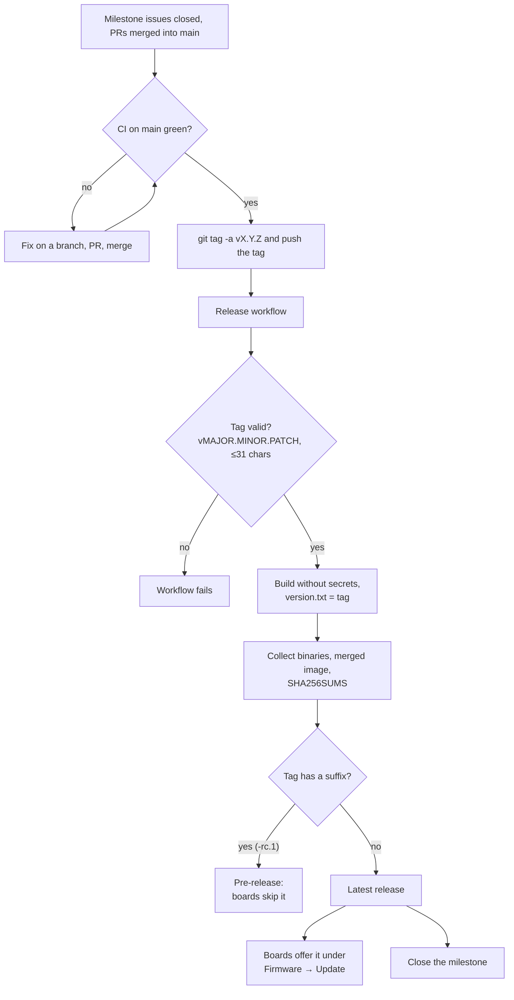

# Releasing

A release is a git tag. Pushing a tag `vMAJOR.MINOR.PATCH` runs [`.github/workflows/release.yml`](.github/workflows/release.yml), which builds the firmware and publishes a GitHub release. Boards offer the latest release under **Update** on the config panel's Firmware page.



## Steps

1. Check that every issue in the GitHub milestone (for example `v0.4.0`) is closed and its PR is merged into `main`.
2. Check that CI on `main` is green:
   ```bash
   gh run list -b main -L 1
   ```
3. Tag `main` and push the tag:
   ```bash
   git checkout main && git pull
   git tag -a v0.4.0 -m v0.4.0
   git push origin v0.4.0
   ```
4. Watch the Release workflow, then check the release's assets:
   ```bash
   gh run watch $(gh run list -w release.yml -L 1 --json databaseId -q '.[0].databaseId')
   gh release view v0.4.0
   ```
5. Close the milestone.

## What the workflow does

- Rejects a tag that isn't `vMAJOR.MINOR.PATCH[-suffix]` or is longer than 31 characters, the limit of `esp_app_desc_t.version`.
- Builds with empty `WIFI_SSID`, `WIFI_PASS` and `HA_TOKEN`, so no local secrets end up in a release.
- Writes the tag to `version.txt`. This is the version the board shows and compares against when it checks for updates.
- Publishes generated release notes with these assets:
  - `ha-screen.bin`: the app, used for over-the-air updates.
  - `mdi_icons.bin`: the icon font.
  - `bootloader.bin`, `partition-table.bin` and `ota_data_initial.bin`.
  - `ha-screen-full.bin`: one image to write at `0x0` for a first USB flash or a recovery.
  - `SHA256SUMS`.

## Pre-releases

A tag with a suffix, such as `v0.5.0-rc.1`, becomes a pre-release. GitHub's "latest" release skips pre-releases, so the boards don't offer them as updates.

## Flashing a release by USB

```bash
esptool.py --chip esp32c6 -p <port> write_flash 0x0 ha-screen-full.bin
```
