# Screenshots

Every screen in each theme and orientation, taken from the board with `tools/screenshot.py`.

## Dark, portrait

**View: Main**

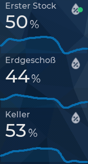 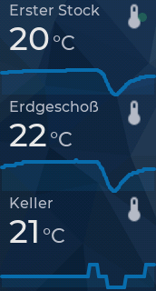 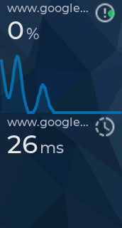 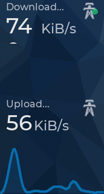 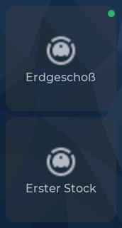

**View: Demo**

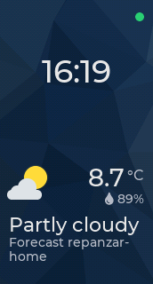 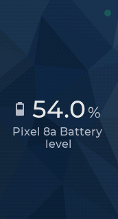 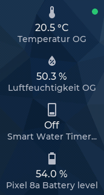 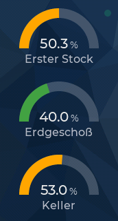 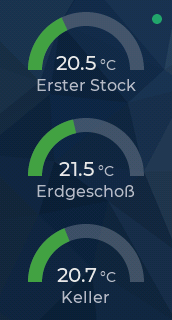

**Config panel (Settings, Display, Errors)**

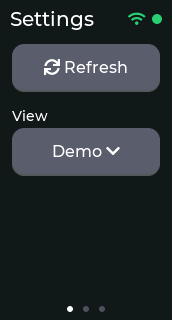 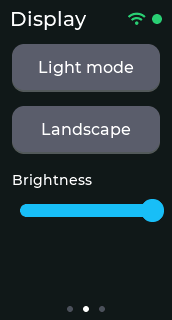 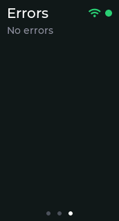

## Dark, landscape

**View: Main**

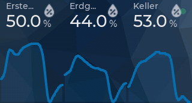 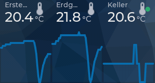 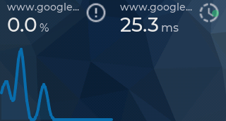 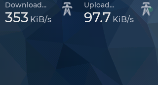 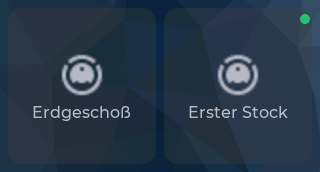

**View: Demo**

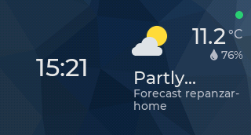 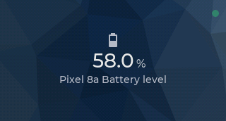 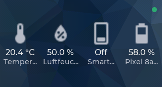 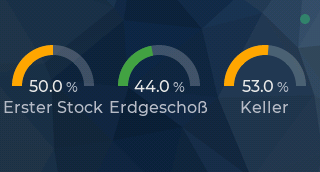 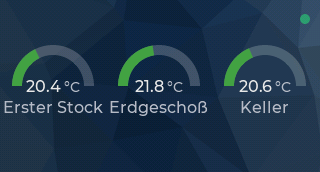

**Config panel (Settings, Display, Errors)**

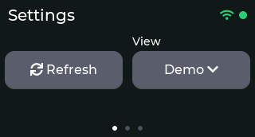 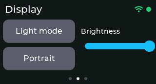 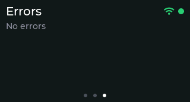

## Light, portrait

**View: Main**

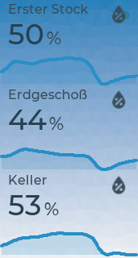 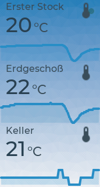 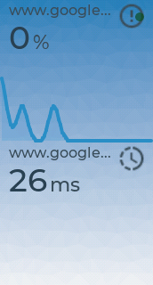 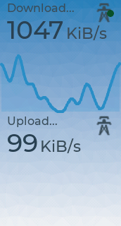 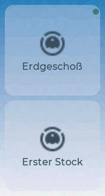

**View: Demo**

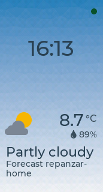 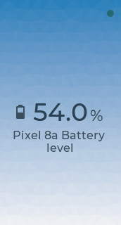 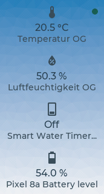 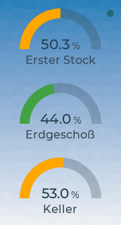 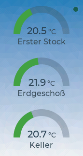

**Config panel (Settings, Display, Errors)**

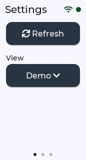 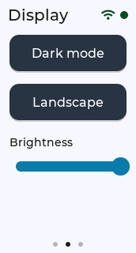 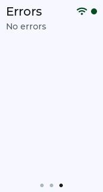

## Light, landscape

**View: Main**

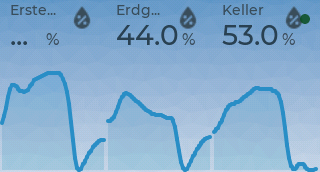 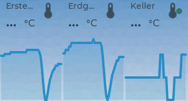 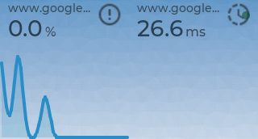 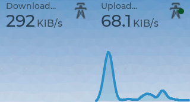 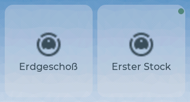

**View: Demo**

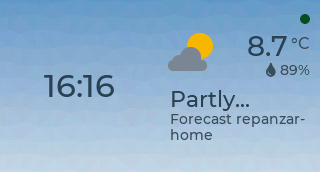 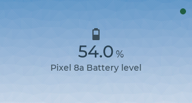 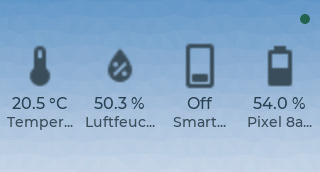 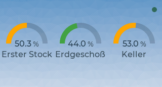 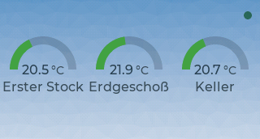

**Config panel (Settings, Display, Errors)**

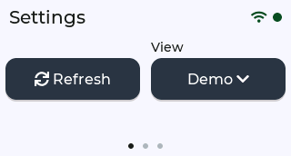  
